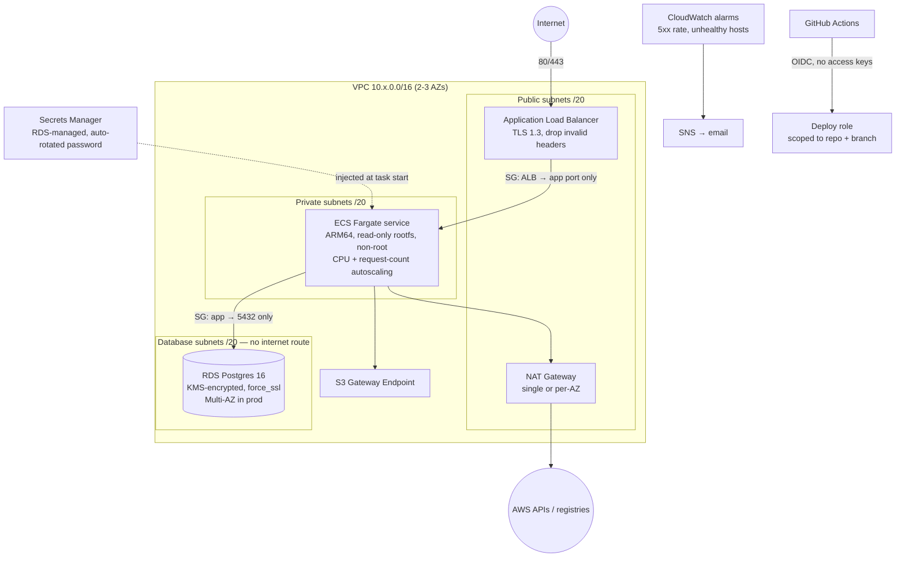

# 01 — Production-Grade AWS Foundation with Terraform

> **Goal:** stand up the infrastructure a real company runs a web service on — multi-AZ networking,
> a load-balanced container service, a managed database, and keyless CI/CD access — entirely as
> code, with tests, two environments, and remote state.

**Skills you'll be able to claim:** VPC design, subnetting, NAT/egress, security groups, ALB, ECS Fargate,
autoscaling, RDS, KMS, Secrets Manager, IAM least privilege, GitHub OIDC federation, Terraform modules,
remote state + locking, `terraform test`, environment promotion, cost control.

**Maps to:** AWS Solutions Architect Associate (SAA-C03), HashiCorp Terraform Associate.

---

## Architecture



### Layout

```
bootstrap/            one-time: remote-state bucket (S3 native locking) + monthly budget alarm
modules/
  network/            VPC, 3 subnet tiers, NAT modes, S3 endpoint, flow logs, default-SG lockdown
  alb/                ALB, HTTP→HTTPS redirect, TLS 1.3 policy, locked-down SG
  ecs-service/        cluster, task def, service, circuit-breaker rollback, autoscaling, alarms, IAM
  rds/                Postgres, KMS key, parameter group (force_ssl), managed master password
  github-oidc/        OIDC provider + role trust policy pinned to repo:owner/name:ref
stack/                composes all modules into one environment (+ tests/ with mocked AWS)
envs/dev, envs/prod   thin roots: backend config + environment sizing only
```

### Design decisions worth talking about in an interview

| Decision | Why |
|---|---|
| Three subnet tiers, DB tier has **no default route** | Even a misconfigured DB security group can't exfiltrate to the internet. |
| `nat_gateway_mode = single \| per_az \| none` | Single NAT is ~$33/mo; per-AZ removes the cross-AZ single point of failure in prod. A trade-off you should be able to defend. |
| `manage_master_user_password = true` | The DB password is generated and rotated by RDS and **never appears in Terraform state**. |
| ECS `deployment_circuit_breaker { rollback = true }` | A bad image rolls itself back instead of paging you. |
| Separate execution role vs task role | The agent's permissions (pull image, read secrets) are not the app's permissions. |
| `ignore_changes = [desired_count]` | Autoscaling owns the count; Terraform shouldn't fight it on every apply. |
| `for_each` over a **map with static keys** for SG rules | IDs are unknown at plan time; a list of them breaks the first apply. (The tests caught this — see below.) |
| ARM64 / Graviton tasks + Fargate Spot in dev | ~20% and ~70% cheaper respectively. Cost is an architecture concern. |
| OIDC trust pinned on the `sub` claim | Without it, **any repo on GitHub** could assume your role. This is a real, common misconfiguration. |

---

## Prerequisites

- AWS account (use a sandbox account, **not** your employer's), AWS CLI v2 configured
- Terraform ≥ 1.10
- ~$1–2/day while dev is running (NAT gateway + ALB + RDS are the bulk). **Destroy when done.**

## Build it

### Step 0 — Test without spending a cent

```bash
cd modules/network && terraform init && terraform test   # 7 tests: CIDR math, NAT modes, validations
cd ../../stack     && terraform init && terraform test   # 4 tests: whole env against a mocked AWS
```

These use `mock_provider "aws"`, so they run offline in CI. When writing this project the stack test
caught two bugs that `terraform validate` happily passed — both would have failed the very first
real `apply`:

1. `for_each = toset(var.allowed_security_group_ids)` — unknown IDs at plan time.
2. `count = var.alarm_sns_topic_arn == null ? 0 : 1` — unknown ARN at plan time.

That's the argument for IaC tests in one paragraph.

### Step 1 — Bootstrap remote state (once per account)

```bash
cd bootstrap
terraform init
terraform apply -var budget_email=you@example.com
terraform output -raw backend_config > ../envs/dev/backend.hcl
cp ../envs/dev/backend.hcl ../envs/prod/backend.hcl
```

### Step 2 — Deploy dev

```bash
cd ../envs/dev
terraform init -backend-config=backend.hcl
terraform plan -out=dev.tfplan -var alarm_email=you@example.com
terraform apply dev.tfplan
curl "$(terraform output -json stack | jq -r .url)/healthz"
```

The default image is `pulse-api` from [project 02](../02-k8s-platform). Until you've pushed it to
your own registry, use any public image that listens on 8080 and serves `/healthz`, e.g.
`-var app_image=public.ecr.aws/nginx/nginx:stable` with `container_port=80` and `health_check_path="/"`.

### Step 3 — Break things on purpose (this is where the learning happens)

1. **Deploy a broken image** (`-var app_image=nginx:does-not-exist`). Watch the ECS console: the
   circuit breaker fails the deployment and rolls back. How long did it take? Where did you see it?
2. **Kill tasks**: `aws ecs stop-task ...` on every task. How long until the ALB is healthy again?
3. **Load test** with `hey -z 2m -c 50 <url>` and watch the requests-per-target policy scale out.
4. **Try to reach the DB from the internet.** Explain exactly which three layers stop you.
5. **Flip dev to `nat_gateway_mode = "none"`** and watch image pulls fail. Then add `ecr.api`,
   `ecr.dkr`, `logs`, `secretsmanager` to `interface_endpoints` and make it work again — that's how
   regulated companies run with zero internet egress.

### Step 4 — Tear down

```bash
terraform destroy          # in envs/dev
```

The bootstrap bucket has `prevent_destroy`; leave it, it costs pennies.

---

## Stretch goals (pick at least two)

- [ ] Add Route 53 + ACM with DNS validation so dev gets HTTPS on a real domain.
- [ ] Add a WAFv2 web ACL (AWS managed rule groups + a rate-based rule) to the ALB.
- [ ] Replace RDS with Aurora Serverless v2 and compare cost at idle vs under load.
- [ ] Enable ALB access logs to an S3 bucket with the correct ELB bucket policy and a 30-day lifecycle.
- [ ] Add a `staging` env and a promotion workflow: same image digest, dev → staging → prod.
- [ ] Use `terraform import` / `import {}` blocks to adopt a resource you created by hand in the console.
- [ ] Run [Infracost](https://www.infracost.io/) on the plan and post the diff as a PR comment.
- [ ] Multi-account: put prod in a separate AWS account via Organizations and assume a role per env.

## Interview questions this project prepares you for

- Walk me through what happens, packet by packet, when a user hits your URL.
- Why can't the database reach the internet? Prove it.
- How do your CI pipelines authenticate to AWS? Why not access keys?
- What happens to Terraform state if two engineers apply at once?
- How would you cut this environment's cost by 50%? What would you give up?
- A deploy went out with a bug. Walk me through how it gets rolled back.
