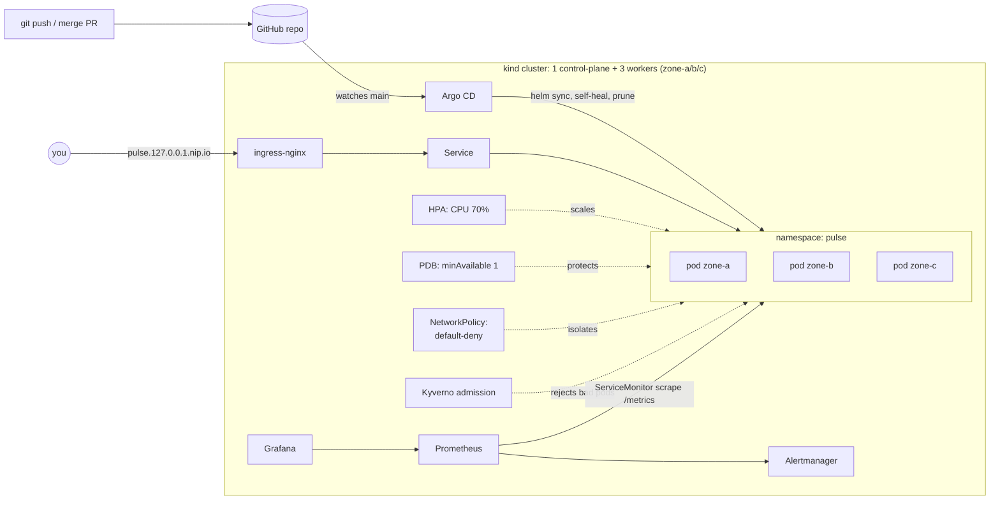

# 02 — Kubernetes Platform: From Go Service to GitOps

> **Goal:** write a production-shaped microservice, package it into a hardened 18 MB image, and run it
> on a multi-zone Kubernetes cluster with autoscaling, disruption budgets, network isolation,
> admission policies, Prometheus monitoring, and GitOps delivery via Argo CD.

**Skills you'll be able to claim:** Go services, container hardening, multi-arch builds, Helm,
Deployments/Services/Ingress, probes, HPA, PDB, topology spread, NetworkPolicy (Calico),
Pod Security, Kyverno policy-as-code, Prometheus Operator, Argo CD, failure drills.

**Maps to:** CKA / CKAD, and the "Kubernetes" line on every platform-engineer job description.

---

## Architecture



### What's in here

```
app/                       pulse-api: Go 1.24, stdlib router, slog JSON logs, Prometheus RED metrics
  cmd/pulse-api/           main: timeouts, SIGTERM → readiness false → drain → graceful Shutdown
  internal/server/         routes, admin auth (constant-time), metrics middleware (+ tests)
  internal/chaos/          runtime fault injection: error rate + latency (+ tests)
  internal/store/          concurrency-safe store behind an interface (+ race tests)
  Dockerfile               multi-stage, multi-arch, distroless:nonroot, cache mounts
charts/pulse-api/          Helm chart: Deployment, Service, Ingress, HPA, PDB, NetworkPolicy, SA, ServiceMonitor
cluster/kind.yaml          4-node cluster with zone labels, Calico instead of kindnet
platform/                  values for ingress-nginx & kube-prometheus-stack, Argo CD Application, alerts
policies/                  Kyverno: no :latest, require resources, require restricted securityContext
Makefile                   make cluster / platform / image / deploy / load / chaos / drill-zone / down
```

### The service: `pulse-api`

| Endpoint | Purpose |
|---|---|
| `GET /healthz` | Liveness — "the process isn't wedged". Never fails during drain. |
| `GET /readyz` | Readiness — flips to 503 on SIGTERM so traffic drains before shutdown. |
| `GET /metrics` | `http_requests_total`, `http_request_duration_seconds` (buckets around the 300 ms SLO), in-flight, build info |
| `GET/POST /api/v1/notes`, `GET/DELETE /api/v1/notes/{id}` | The "business" API |
| `GET /api/v1/work?ms=100` | Burns CPU — your HPA demo button |
| `GET/PUT /admin/chaos` | Inject errors/latency at runtime. Bearer-token protected; 404 when no token configured. |

Things the code does that interviewers notice:

- **Route-pattern metric labels**, never raw paths — `/notes/123` and `/notes/456` share one series.
  A test enforces it. (Raw-path labels are a classic way to OOM Prometheus.)
- **Graceful shutdown done right**: readiness fails *first*, then a drain window, then `Shutdown()`.
  Without this, every rolling deploy drops a few requests. You can prove it with the load test.
- **Server timeouts** (`ReadHeaderTimeout` etc.) — Go's defaults are "forever", i.e. Slowloris-able.
- **Bounded request bodies** (`MaxBytesReader`) and capped CPU burn.

---

## Prerequisites

`docker`, [`kind`](https://kind.sigs.k8s.io/), `kubectl`, `helm`, `go` 1.24+, optionally
[`kubeconform`](https://github.com/yannh/kubeconform). ~6 GB free RAM for the full platform.
Cost: **$0** — it's all on your laptop.

## Build it

```bash
make test        # go test -race
make lint        # helm lint + kubeconform strict schema validation
make cluster     # kind + Calico                                   (~2 min)
make platform    # ingress, metrics-server, Prometheus/Grafana, Kyverno, Argo CD   (~5 min)
make image       # docker build + kind load
make deploy      # helm install into namespace "pulse"
curl http://pulse.127.0.0.1.nip.io/
```

Grafana: http://grafana.127.0.0.1.nip.io (admin / admin).

## Labs — do every one of these and write down what you saw

1. **Autoscaling.** `make load` in one terminal, `kubectl -n pulse get hpa,pods -w` in another.
   How long from load start to the first new pod? Why does scale-*down* take 5 minutes?
2. **Zero-downtime deploys.** Run `hey -z 60s http://pulse.127.0.0.1.nip.io/api/v1/notes` while you
   `make image deploy VERSION=0.1.1`. Count non-200s. Now set `SHUTDOWN_DRAIN_SECONDS=0` and repeat.
   Explain the difference.
3. **Zone failure.** `make drill-zone`. Do pods reschedule? Does the PDB stop the drain from taking
   too many at once? `make undrill`.
4. **Network isolation.** `kubectl run -it --rm attacker --image=curlimages/curl:8.10.1 -- curl -m 3 pulse-api.pulse.svc`
   from the `default` namespace. It should time out. Which NetworkPolicy rule blocks it?
   (This only works because we swapped kindnet for Calico — kindnet ignores NetworkPolicy.)
5. **Admission control.** `kubectl apply -f policies/test-bad-pod.yaml` — Kyverno rejects it. Read the
   error, fix the pod until it's admitted.
6. **Chaos → alert.** `make chaos ERROR_RATE=0.3`. Watch `PulseHighErrorRate` go pending → firing in
   Prometheus (`kubectl -n monitoring port-forward svc/kube-prometheus-stack-prometheus 9090`).
7. **GitOps.** Push the image to GHCR (project 04's pipeline does it), `make gitops`, then
   `kubectl -n pulse scale deploy/pulse-api --replicas=1`. Argo CD's self-heal reverts you. Change
   `replicaCount`/HPA min in git instead and watch it roll out.
8. **OOM.** Set `resources.limits.memory=8Mi` and deploy. What does `kubectl describe pod` say? What
   would the alert in `platform/pulse-alerts.yaml` do?

## Stretch goals

- [ ] Run it on **EKS** using project 01's VPC (private subnets are already tagged for load balancers).
      Use IRSA or EKS Pod Identity for the service account.
- [ ] Add **cert-manager** with a self-signed ClusterIssuer and turn on `ingress.tls`.
- [ ] Replace the in-memory store with Postgres (CloudNativePG operator) — the `Store` interface is the seam.
- [ ] Add **OpenTelemetry tracing** and ship spans to Tempo or Jaeger.
- [ ] Progressive delivery: **Argo Rollouts** canary that aborts automatically on the error-rate query.
- [ ] Use **KEDA** to scale on requests-per-second from Prometheus instead of CPU.
- [ ] Write a Kyverno `mutate` policy that injects default resources into pods that lack them.

## Interview questions this prepares you for

- What's the difference between liveness, readiness and startup probes? What breaks if you point liveness at a DB check?
- Walk me through what happens between `kubectl delete pod` and the process exiting.
- Why no CPU limit? When would you add one?
- How does a PodDisruptionBudget interact with a node drain? With a cluster autoscaler?
- How do you stop a team from deploying `:latest` to prod?
- What's GitOps and why would you want the cluster to pull rather than CI to push?
