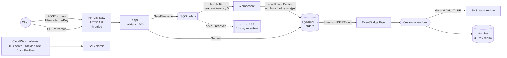

# 03 — Serverless, Event-Driven Order Pipeline

> **Goal:** build the asynchronous backbone that real e-commerce, fintech and logistics systems run on.
> It has to survive duplicate deliveries, poison messages, retry storms and downstream outages without
> losing or double-counting a single order, and it has to cost close to $0 at idle.

**Skills you'll be able to claim:** API Gateway HTTP APIs, Lambda (ARM64), SQS + DLQ + redrive,
partial batch failures, idempotency, DynamoDB (on-demand, PITR, TTL, Streams), EventBridge
(Pipes, custom bus, content-based routing, archive/replay), SNS, X-Ray, CloudWatch alarms,
least-privilege IAM, testing AWS code with `moto`.

**Maps to:** AWS Developer Associate (DVA-C02), the serverless half of SAA-C03, and every
"design an order system" system-design interview.

---

## Architecture



### The failure modes it's built for, and how it handles them

| What goes wrong | What the design does about it |
|---|---|
| Client times out and retries the POST | The order ID is `uuid5(customer, Idempotency-Key)`, so a retry gets the **same** ID. |
| SQS delivers a message twice (it will — it's at-least-once) | `ConditionExpression="attribute_not_exists(pk)"` turns the duplicate into a no-op. Tested. |
| One malformed message in a batch of 10 | `ReportBatchItemFailures`: only that message is retried; the other 9 are deleted. |
| A message that can never succeed | After `maxReceiveCount=3` it moves to the DLQ, an alarm fires, and `scripts/redrive_dlq.sh` sends it back once you've fixed the bug. |
| Processor is slow and the queue backs up | `maximum_concurrency=5` stops a backlog from stampeding the database. The backlog-age alarm tells you it's happening. |
| A Lambda is still working when the visibility timeout expires | Visibility timeout = 6 × function timeout, as AWS recommends. A Terraform test enforces it. |
| **Write to DB succeeds, publishing the event fails** | This is the subtle one. The Lambda never publishes. The DynamoDB stream acts as a **transactional outbox**, and an EventBridge Pipe turns each INSERT into an event, so the event exists exactly when the row exists. |
| A new team wants every order from last month | The EventBridge archive lets you replay into their new rule. |

> The first draft of this project published to EventBridge from inside the processor. Work out why
> that loses events (hint: what does the retry see?) before you read `src/processor/handler.py`.
> It's a common interview question.

---

## Layout

```
src/api/handler.py          POST /orders, GET /orders/{id}; Decimal money maths, strict validation
src/processor/handler.py    SQS consumer; idempotent write; partial batch failures; poison handling
tests/                      26 pytest tests with moto, including a full API→SQS→λ→DynamoDB lifecycle
terraform/                  the whole stack + tests/pipeline.tftest.hcl (6 architecture guardrails)
scripts/send_orders.py      load + retry + poison-message generator
scripts/redrive_dlq.sh      inspect and redrive the DLQ
```

## Build it

```bash
# 1. Unit + integration tests: no AWS account needed
python3 -m venv .venv && source .venv/bin/activate
pip install -r requirements-dev.txt
pytest -v

# 2. Infrastructure guardrail tests: no AWS account needed
cd terraform && terraform init && terraform test

# 3. Deploy (~2 min). Costs ≈ $0 idle; pennies under the load test.
terraform apply -var alert_email=you@example.com
API=$(terraform output -raw api_url)

# 4. Use it
curl -s -XPOST "$API/orders" -H 'Idempotency-Key: my-first-order-1' \
  -d '{"customer_id":"me","items":[{"sku":"BOOK","qty":2,"unit_price":"12.50"}]}'
curl -s "$API/orders/<order_id from above>"
```

## Labs

1. **Prove idempotency at scale.** `python3 ../scripts/send_orders.py --url $API -n 500 -c 25 --retry-rate 0.3`
   then `aws dynamodb scan --table-name orders-orders --select COUNT`. It should be exactly 500.
2. **Poison messages.** `--poison 5 --queue-url ...`. Watch the messages get received 3 times
   (CloudWatch: `NumberOfMessagesReceived`), land in the DLQ, and set off `orders-dlq-not-empty`.
   Then redrive them with `scripts/redrive_dlq.sh`. What happens to them next, and why?
3. **Downstream outage.** Attach an inline deny on `dynamodb:PutItem` to the processor role. Send
   orders. The API keeps returning 202 and the queue holds the work. Remove the deny within about
   3 minutes (3 receives × 60 s visibility) and watch the backlog drain. Wait longer and the orders
   end up in the DLQ instead, so you redrive them. Either way nothing is lost, and that's the main
   reason to put a queue in front of a database.
4. **Throttling.** Set `api_throttle_rps=2`, apply, and run the load script. Which status code do you
   get? Where does it show up in the access logs?
5. **Trace a request.** Open X-Ray's service map. Where does the time go on a cold start compared with
   a warm invocation?
6. **Replay.** Add a second EventBridge rule (say, a CloudWatch Logs target for all orders), then
   start a replay from the archive covering the last hour.

## Stretch goals

- [ ] Add an authorizer: Cognito user pool JWT authorizer on the HTTP API.
- [ ] Replace manual JSON logs with **AWS Lambda Powertools** (logger, tracer, metrics, idempotency utility).
- [ ] Add a **Step Functions** saga for payment → inventory → shipping with compensation on failure.
- [ ] Run it with **SQS FIFO** and `MessageGroupId=customer_id` so each customer's orders are processed in order. What does that do to throughput?
- [ ] Deploy with **Lambda aliases + CodeDeploy canary** (10% for 5 minutes, auto-rollback on alarm).
- [ ] Add a **CloudWatch dashboard** in Terraform covering queue depth, age, Lambda duration p99 and errors.
- [ ] Load test to 1,000 rps and find the first bottleneck. (Hint: account concurrency, API throttle, or `maximum_concurrency`?)

## Interview questions this prepares you for

- How do you guarantee exactly-once processing on top of an at-least-once queue?
- What's a dead-letter queue for? How do you get messages back out of one safely?
- Explain the dual-write problem and two ways to solve it.
- Why return 202 rather than 201 from `POST /orders`?
- When would you choose SQS, SNS, EventBridge or Kinesis?
- What does Lambda concurrency mean, and how can a queue backlog take down your database?
