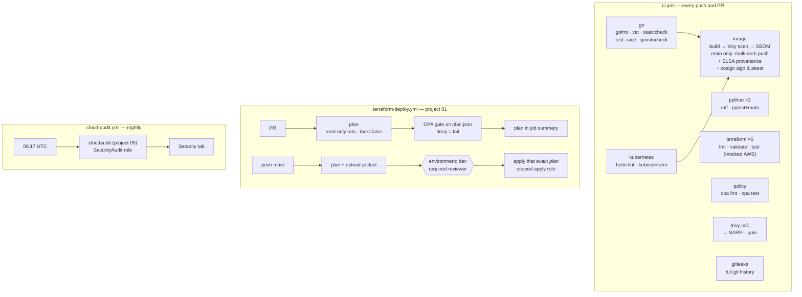

# 04 — DevSecOps Pipeline: Secure Software Supply Chain + Policy-as-Code

> **Goal:** build the CI/CD system that guards every other project in this repo. It tests and lints
> six projects in four languages, scans IaC, images and git history, gates infrastructure changes
> with policy-as-code, signs images keylessly, and deploys with short-lived credentials and human
> approval. **No AWS access keys exist anywhere.**

**Skills you'll be able to claim:** GitHub Actions (matrix, environments, concurrency, OIDC),
supply-chain security (SHA pinning, SBOM, SLSA provenance, Sigstore/cosign), SAST/IaC/container
scanning (Trivy, gitleaks, govulncheck, staticcheck), OPA/Rego policy-as-code, plan → review →
apply workflows, least-privilege CI roles.

**Maps to:** DevSecOps / platform engineer roles; the "how do you secure your pipeline?" question
that has become standard since SolarWinds, Codecov and the GitHub Action tag-hijacking incidents.

---

## The pipelines

The workflows live at the repo root in [`.github/workflows/`](../.github/workflows), since that's where GitHub looks.



### Defenses, and what each one stops

| Control | Where | Threat it stops |
|---|---|---|
| Actions pinned to **commit SHAs**, with the version in a comment | all workflows | A compromised or re-tagged action (the tj-actions/changed-files and trivy-action incidents). Dependabot keeps the SHAs current. |
| `permissions: contents: read` by default; jobs opt in | all workflows | A compromised step using `GITHUB_TOKEN` to push code or rewrite releases. |
| `persist-credentials: false` on checkout | all workflows | Later steps or scripts reading the token out of `.git/config`. |
| **OIDC → STS** with `sub` pinned to repo + branch/environment | deploy, audit | Leaked long-lived keys. A fork or other repo assuming your role. |
| PR plans use a **read-only** role and **read-only state** | `bootstrap/github.tf` | A malicious PR changing infra or tampering with state during `plan`. |
| Apply requires a **GitHub Environment approval** and applies the **saved plan** | deploy | Unreviewed changes, and the plan changing between review and apply. |
| **OPA policies** on the plan JSON | `policy/terraform` | Public DBs, `0.0.0.0/0:22`, `*:*` IAM, IMDSv1, access keys, before they exist. |
| **Trivy config** + documented `.trivyignore.yaml` | ci | IaC misconfigurations. Every exception needs a written justification. |
| **Trivy image**, failing on fixable HIGH/CRITICAL | ci | Shipping known CVEs. |
| **govulncheck** | ci | Vulnerable Go code paths that are actually *reachable* (fewer false positives than SCA). |
| **gitleaks** over full history | ci + pre-commit | Secrets committed in the past, not just in this diff. |
| **SBOM** (SPDX) + **SLSA provenance** + **cosign keyless signature** | ci (main) | Unknown contents, and images not built by your CI. `scripts/verify-image.sh` checks it. |

### These controls already found real bugs while this repo was being built

These were not planted. Each one turned up while the repo itself was going through the pipeline:

1. **Trivy image scan: 24 fixable HIGH/CRITICAL CVEs → 0.** The first Dockerfile used Go 1.24.
   Trivy flagged stdlib and `klauspost/compress` vulnerabilities. Moving to Go 1.27.3 and
   `go get -u` cleared every one.
2. **Trivy AWS-0136 found a functional bug, not just a compliance gap.** SNS topics encrypted with
   the AWS-managed `alias/aws/sns` key **silently drop** messages from CloudWatch Alarms and
   EventBridge, because that key's policy can't trust those services. Every alarm in projects 01
   and 03 would have gone nowhere. The fix is a CMK with a service-scoped key policy
   (`01/modules/sns-topic`, `03/terraform/kms.tf`).
3. **Trivy AWS-0104** pushed ECS egress from "all traffic, anywhere" down to 443 out plus 5432 inside the VPC.
4. **staticcheck** caught deprecated Prometheus collector APIs.
5. **gitleaks** flagged a test fixture that looked like an API key. That turned into a lesson in
   cleaning history before the first push.
6. **Resolving action tags to SHAs**: three of the actions use *annotated* tags, where
   `git ls-remote` returns the tag object's SHA rather than the commit's. Pinning to that would have
   broken CI. Always dereference with `^{}`.

---

## Policy-as-code

`policy/terraform/security.rego` runs against `terraform show -json tfplan` output:

| Rule | Type |
|---|---|
| Ingress from `0.0.0.0/0` on 22, 3389, 3306, 5432, 6379, 27017, 9200 (incl. port ranges) | deny |
| `aws_db_instance` public or unencrypted | deny |
| S3 public access block not fully on; public canned ACLs | deny |
| IAM `Action:*` + `Resource:*` (string or array form); `AdministratorAccess` attachments | deny |
| `aws_iam_access_key` (long-lived keys) | deny |
| EC2 without IMDSv2 required | deny |
| Log groups with infinite retention; DBs without deletion protection | warn |

```bash
opa test policy -v                                   # 19 unit tests
terraform show -json tfplan > plan.json
opa eval --fail-defined -d policy/terraform -i plan.json 'data.main.deny[msg]'
```

## Set it up on your fork

1. Run project 01's bootstrap with `-var github_repository=<you>/<repo>`. It prints three role ARNs.
2. In the repo settings, under *Secrets and variables → Actions → **Variables***, add `AWS_REGION`,
   `TF_STATE_BUCKET`, `AWS_PLAN_ROLE_ARN`, `AWS_APPLY_ROLE_ARN` and `AWS_AUDIT_ROLE_ARN`.
   These are *variables*, not secrets. Role ARNs aren't sensitive, and that's the point of OIDC.
3. Under *Environments*, create `dev` with yourself as a required reviewer.
4. Under *Branches*, protect `main`: require PRs and the `ci` checks, and block force pushes.
5. Under *Code security*, enable code scanning so the SARIF uploads show up.
6. Locally: `pip install pre-commit && pre-commit install`.

Until the variables are set, the deploy and audit workflows skip themselves, so `ci` is green from the first push.

## Labs

1. **Break a policy on purpose.** In a PR, set `publicly_accessible = true` in `modules/rds`. Watch
   the plan job fail with the deny message. Then try to sneak it past with a `count` trick or a
   dynamic block. Does the policy still catch it? (It does: it reads the *plan*, not the HCL.)
2. **Verify your image.** After a main build: `scripts/verify-image.sh ghcr.io/<you>/pulse-api@sha256:...`.
   Then push an image by hand with `docker push` and try to verify that one.
3. **Introduce a CVE.** `go get github.com/klauspost/compress@v1.17.9` and push. Which job fails, and with which CVE?
4. **Plant a fake secret.** Commit an AWS-style key in a branch. gitleaks fails. Delete it in a
   second commit: it *still* fails, because history is scanned. Clean the history properly.
5. **Tamper test.** Edit a pinned SHA to a tag (`@v4`). Why is that worse, even though it looks cleaner?

## Stretch goals

- [ ] Admission-time verification: a Kyverno `verifyImages` policy (project 02) that only admits pulse-api images signed by this workflow.
- [ ] Add CodeQL for Go and Python.
- [ ] Use `step-security/harden-runner` to audit and then block unexpected egress from CI jobs.
- [ ] Add OpenSSF Scorecard and work toward a score of 8 or more.
- [ ] Add Infracost to the plan job and fail PRs that add more than $50/month.
- [ ] Promote the same signed digest dev → prod with a second environment and a manual approval.
- [ ] Generate provenance with the SLSA GitHub generator to reach SLSA Build L3.

## Interview questions this prepares you for

- How do your pipelines authenticate to the cloud? What stops another repo from using the same role?
- What's an SBOM for? What's the difference between an SBOM and provenance?
- How would you know if someone pushed an image to your registry outside CI?
- Why pin actions to SHAs? What's the operational cost, and how do you manage it?
- Your scanner reports 300 findings. How do you roll it out without the team ignoring it?
- Walk me through the controls between a developer's laptop and production.
