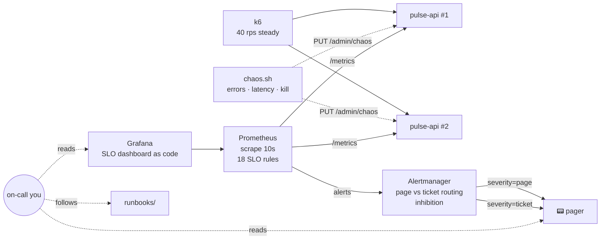

# 06 — SRE: SLOs, Burn-Rate Alerting, Chaos Game Days & Incident Response

> **Goal:** run a service the way Google-style SRE teams do. Define SLIs that reflect what users
> experience, set SLOs with an error-budget policy, alert on **budget burn** instead of
> thresholds, unit-test those alerts, then break things on purpose in a structured game day and
> write it up as a blameless postmortem.

**Skills you'll be able to claim:** SLI/SLO/error-budget design, PromQL and recording rules,
multi-window multi-burn-rate alerting, alert unit tests (`promtool test rules`), Alertmanager
routing and inhibition, Grafana dashboards as code, load testing with k6, chaos engineering,
runbooks, incident command, postmortems.

**Maps to:** SRE / production engineering roles, and the on-call half of every platform role.

---

## Architecture



The service under test is `pulse-api` from [project 02](../02-k8s-platform). It already exports
RED metrics with histogram buckets placed around the 300 ms SLO, and it has a built-in fault injector.

### What's here

```
SLO.md                         the SLO document: SLIs, targets, alert design, error budget policy
prometheus/rules/slo.yml       recording rules (8 windows) + burn-rate and symptom alerts
prometheus/tests/slo_test.yml  promtool unit tests: when each alert must fire AND must not fire
alertmanager/alertmanager.yml  page/ticket routing, grouping, inhibition
grafana/                       provisioned datasource + SLO dashboard (JSON, in git)
k6/load.js                     constant-arrival-rate load with k6-side SLO thresholds
chaos/chaos.sh                 game-day faults: errors, slow-burn, latency, partial, kill, blackout
pager/pager.py                 a fake phone that prints pages and tickets
runbooks/                      one per alert, linked from each alert's runbook_url
postmortem-template.md         blameless format, with action-item rules
GAMEDAY.md                     a facilitated 90-minute exercise
```

---

## Build it

```bash
# 1. Test the alerting logic. No containers needed: these encode the SLO maths.
promtool check rules prometheus/rules/slo.yml
promtool test rules prometheus/tests/slo_test.yml

# 2. Bring up the lab
docker compose up -d --build
docker compose run --rm k6 &          # steady load (30 min by default; RPS=… DURATION=… to override)
open http://localhost:3000            # Grafana: SLO dashboard is the home page
docker compose logs -f pager          # your "phone"

# 3. Break it
./chaos/chaos.sh errors 0.2           # → page in ~2.5 minutes
./chaos/chaos.sh heal

# 4. Clean up
docker compose --profile load down -v
```

### What the alert tests prove

| Scenario | Asserted behavior |
|---|---|
| 0.05% errors (half the budget) for 6h | No alerts, ever. Budget remaining = exactly 50%. |
| 10% errors for 30 minutes | **No** page at +2 min. Page at +15 min. Still paging 10 min after recovery (the 6h/30m pair holds it, which prevents flapping). Resolved at +35 min. |
| 0.5% errors for 26h | Slow-burn **ticket**, never a page. |
| 20% of requests > 300 ms | Latency page. All-slow traffic to `/api/v1/work` is correctly **excluded**. |
| One replica down / both down | Ticket, then page. |

Writing these tests corrected the author's own assumption. The draft test expected the page to clear
10 minutes after recovery. It doesn't, by design, and that's now documented in the test.

### Measured in this lab (not theory)

When I ran the full stack with 40 rps and then `chaos.sh errors 0.2`:

```
t+40s   PulseErrorBudgetBurnFast: pending
t+160s  PulseErrorBudgetBurnFast: firing
[00:05:42] 🚨 PAGE FIRING   PulseErrorBudgetBurnFast: pulse-api is burning its availability error budget fast
           runbook: https://github.com/kbaker06/Cloud-Project-/blob/main/06-sre-observability/runbooks/high-error-rate.md
```

and every dashboard panel had live data: a 1h burn rate of 129× and error budget remaining at
−12,800%. That second number looks alarming because the "30-day" window only held the lab's few
minutes of data. At a steady 20% error rate (200× burn), a real month's budget would last
30 days ÷ 200 ≈ **3.6 hours**.

---

## Labs

1. **Run the [game day](GAMEDAY.md).** Have a friend run `chaos.sh` without telling you which scenario they picked.
2. **Why multi-window?** Temporarily change the fast-burn alert to *only* `ratio_rate1h > 0.0144`. Run
   `errors 0.2` for 3 minutes, then `heal`. How long does the alert keep firing after recovery?
   Now restore the 5m window and repeat.
3. **Partial failure.** `chaos.sh partial`. One replica fails half its requests. The aggregate
   error rate is about 25%. Find *which* replica using only Grafana and PromQL, then "fix" it by stopping it.
4. **Alert fatigue.** Replace the SLO alerts with the classic `error_rate > 1% for 1m`. Run
   `slow-burn` and then a few short `errors 0.05` blips. Count the pages. Compare.
5. **Budget policy in practice.** After the game day, read `slo:error_budget_remaining:ratio`.
   According to [SLO.md](SLO.md#error-budget-policy), are you allowed to deploy features?
6. **Write the postmortem** for your game day, using the template. Include budget consumed and real timestamps.

## Stretch goals

- [ ] Port the rules to project 02's cluster as a `PrometheusRule` CR and route to a real Slack/PagerDuty receiver.
- [ ] Generate the rules from a spec with [Sloth](https://sloth.dev) or [Pyrra](https://github.com/pyrra-dev/pyrra), and compare the output with the hand-written version.
- [ ] Add a **blackbox exporter** synthetic probe SLI, which measures what the server-side SLI can't see.
- [ ] Add **Loki** for logs and **Tempo** for traces, with exemplars linking a latency spike to a specific trace.
- [ ] Use **Chaos Mesh** or **Litmus** on the k8s cluster: pod kill, network latency and partition between pods.
- [ ] Add CloudWatch versions of these burn-rate alarms (metric math) to project 01's ECS service.

## Interview questions this prepares you for

- What's the difference between an SLI, an SLO and an SLA? Who sets each?
- Why not alert on CPU > 80%? What *should* page someone at 3 a.m.?
- Explain burn rate. Why 14.4? (2% of a 30-day budget in 1 hour: 0.02 × 720 h.)
- Your SLO is 99.9% and you're at 99.95%. Should you slow down? Speed up?
- Walk me through the first 10 minutes of an incident you were paged for.
- What makes a postmortem blameless, and why does it matter?
