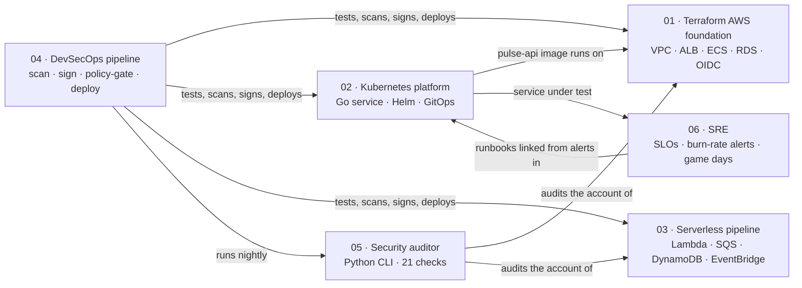

# Cloud Engineering Portfolio: Six Production-Grade Projects

Six connected projects covering what cloud, platform, DevOps, security and SRE engineers actually
do at work: infrastructure as code, containers and Kubernetes, serverless event systems, a secure
CI/CD supply chain, security automation, and SLO-based operations.

They aren't toy demos. Each one has **tests that run without an AWS bill**, and each one went
through its own security tooling while it was built. That turned up real bugs, all documented below.



| # | Project | You'll prove you can… | Stack | Tests | Cost to run |
|---|---|---|---|---|---|
| 01 | [Terraform AWS Foundation](01-terraform-aws-foundation) | Design multi-AZ, least-privilege AWS infra with modules, remote state, two environments and keyless CI access | Terraform, VPC, ALB, ECS Fargate, RDS, KMS, IAM OIDC | 11 `terraform test` (mocked AWS) | ~$1–2/day while up |
| 02 | [Kubernetes Platform](02-k8s-platform) | Write a production-shaped service and run it on K8s with autoscaling, isolation, admission policy and GitOps | Go, Docker, Helm, kind, Calico, Kyverno, Argo CD, Prometheus | Go unit tests (`-race`), kubeconform | $0 (laptop) |
| 03 | [Serverless Event Pipeline](03-serverless-event-pipeline) | Build an at-least-once pipeline that never loses or duplicates an order | API Gateway, Lambda, SQS+DLQ, DynamoDB Streams, EventBridge Pipes | 26 pytest (moto) + 6 `terraform test` | ≈ $0 idle |
| 04 | [DevSecOps Pipeline](04-devsecops-pipeline) | Secure the supply chain end to end and gate infra changes with policy-as-code | GitHub Actions, OIDC, Trivy, gitleaks, cosign, SBOM, SLSA, OPA | 19 OPA tests | $0 |
| 05 | [Cloud Security Auditor](05-cloud-security-auditor) | Ship a real tool: multi-region AWS scanning, baselines, SARIF, CI exit codes | Python, boto3, moto | 34 pytest (moto) | $0 (read-only) |
| 06 | [SRE & Observability](06-sre-observability) | Define SLOs, alert on error-budget burn, run a chaos game day, write a postmortem | Prometheus, Alertmanager, Grafana, k6 | 5 promtool alert-test suites | $0 (laptop) |

## Recommended order

1. **02 → 06** first, at $0 on your laptop. They teach containers, Kubernetes, metrics and on-call
   without a cloud bill.
2. **05** next: still $0, and it teaches the AWS security model by *checking* for it.
3. **01**, then **03** in a sandbox AWS account. Set up the budget alarm in `01/bootstrap` **first**.
4. **04** throughout: fork the repo, set the variables, and let CI guard everything you change.

Each project README has the architecture, design decisions, step-by-step build, **labs where you
break things on purpose**, stretch goals, and the interview questions it prepares you for.

## Bugs the tooling caught while this repo was being built

Interviewers ask "tell me about a time you found a bug before production". These are real:

| Found by | Bug | Would have caused |
|---|---|---|
| `terraform test` (mocked) | `for_each` over security-group IDs that are unknown at plan time | First real `apply` fails |
| `terraform test` (mocked) | `count` depending on an SNS ARN that is unknown at plan time | First real `apply` fails |
| Trivy AWS-0136 | SNS topics encrypted with `alias/aws/sns` | **Every CloudWatch alarm and EventBridge rule silently undelivered** |
| Trivy image scan | Go 1.24 toolchain plus outdated dependencies | 24 fixable HIGH/CRITICAL CVEs shipped |
| Trivy AWS-0104 | ECS tasks allowed all egress | Easy exfiltration path |
| Design review (03) | Lambda wrote to DynamoDB, then published to EventBridge | Lost events on partial failure (dual write). Replaced with a Streams + Pipes outbox |
| Lab walkthrough (02) | NetworkPolicy blocked the in-namespace load generator | Lab 1 couldn't work |
| `promtool test rules` | Assumed the page clears 10 min after recovery | Wrong runbook expectations. The 6h/30m window holds it about 30 min, by design |
| staticcheck | Deprecated Prometheus collector APIs | Break on a future client upgrade |
| gitleaks | A test fixture that looked like an API key | CI failure. History cleaned before the first push |
| SHA pinning | Annotated tags resolve to tag objects, not commits | Every workflow fails to start |

## Running all the tests locally

```bash
# Terraform: no AWS credentials needed
for d in 01-terraform-aws-foundation/{modules/network,stack} 03-serverless-event-pipeline/terraform; do
  (cd $d && terraform init -backend=false && terraform test); done

# Go
(cd 02-k8s-platform/app && go test -race ./...)
(cd 02-k8s-platform && make lint)

# Python
(cd 03-serverless-event-pipeline && pip install -r requirements-dev.txt && pytest)
(cd 05-cloud-security-auditor && pip install -e '.[dev]' && pytest)

# Policy, alerts, security scans
opa test 04-devsecops-pipeline/policy
promtool test rules 06-sre-observability/prometheus/tests/slo_test.yml
trivy config --config trivy.yaml .
gitleaks git .
```

CI runs all of this on every push. See [`.github/workflows/ci.yml`](.github/workflows/ci.yml).

## Cost safety

- `01/bootstrap` creates a **monthly AWS Budget** with email alerts at 50%, 80% and 100% (forecast). Apply it before anything else.
- The expensive parts are NAT gateways (~$33/month each), the ALB (~$16/month) and RDS. **`terraform destroy` when you're done for the day.**
- 03's serverless stack costs close to nothing at idle. 02, 05 and 06 run locally for free.
- Use a dedicated sandbox account (AWS Organizations makes this free), never a work account.

## Certification mapping

| Cert | Most relevant projects |
|---|---|
| AWS Solutions Architect – Associate | 01, 03 |
| AWS Developer – Associate | 03, 04 |
| AWS Security – Specialty | 05, 04, 01 |
| HashiCorp Terraform Associate | 01, 03 |
| CKA / CKAD | 02 |
| (no cert; asked in every SRE loop) | 06 |
